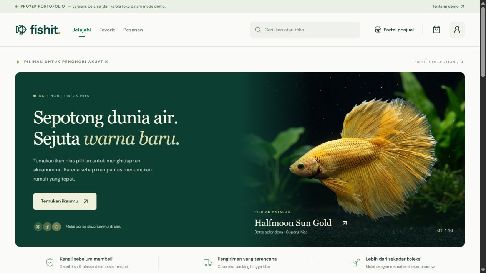

# Fishit

**Sepotong dunia air. Sejuta warna baru.**

Fishit adalah demo marketplace ikan hias yang dibuat oleh **Nadzirin** untuk proyek UAS Technopreneurship, kemudian dikembangkan menjadi proyek portofolio interaktif. Fokusnya adalah pengalaman menjelajahi katalog, mencoba alur belanja, dan melihat sudut pandang penjual pada desktop, tablet, serta ponsel.



## Coba alurnya

1. Jelajahi 30 produk awal dalam 21 kategori. Cari berdasarkan ikan, toko, atau kota; pilih kategori; urutkan harga/rating; simpan favorit.
2. Tambahkan produk ke keranjang. Jumlah dibatasi oleh stok demo.
3. Masuk menggunakan nama panggilan contoh, lalu pilih pengiriman atau ambil di toko.
4. Selesaikan **pembayaran simulasi**. Tidak ada QR yang perlu dipindai, nomor rekening, atau tagihan sungguhan.
5. Buka **Pesanan**, simulasikan tahap pengiriman, lalu berikan ulasan setelah selesai. Pesanan yang belum diproses bisa dibatalkan dan stoknya dikembalikan.
6. Buka **Portal penjual** untuk mengelola Aquatic Studio. Empat produk awal sudah tersedia; coba tambah, edit, atau sembunyikan produk. Pesanan dari produk toko ini muncul di panel penjual.
7. Gunakan **Reset demo** di footer untuk mengembalikan seluruh data versi ini ke kondisi awal.

## Fitur

- Layout empat kolom di desktop, tiga kolom di tablet, dan dua kolom di ponsel; navigasi bawah untuk layar kecil.
- Detail produk, ulasan demo, wishlist, pencarian, kategori, filter stok, dan pengurutan.
- Checkout beberapa toko dengan pemisahan pesanan dan ongkir per toko.
- Harga dan detail produk disalin ke pesanan agar riwayat tidak berubah saat katalog diedit.
- Pelacakan bertahap dengan waktu perubahan status, pengambilan langsung, pembatalan, dan ulasan pesanan selesai.
- Dashboard penjual dengan stok, foto lokal, pengarsipan, dan pendapatan dari nilai produk pada pesanan selesai.
- Chat dengan balasan otomatis lokal; tidak mengirim pesan ke pihak lain.
- Persistensi browser, sinkronisasi perubahan antartab, fallback untuk data rusak, dan pemberitahuan jika penyimpanan penuh/diblokir.
- Dialog native dengan fokus modal, Escape, pengembalian fokus, label kontrol, dan dukungan reduced motion.
- Gambar katalog dilayani dari folder lokal dengan placeholder jika gambar gagal dimuat.

## Menjalankan secara lokal

Gunakan Node.js **22.12+ atau 24+** dan npm. Pengembangan serta pemeriksaan proyek ini dilakukan menggunakan Node.js 24.

```bash
npm ci
npm run dev
```

Buka alamat yang ditampilkan Vite. Perintah lain:

```bash
npm run lint      # Analisis statis
npm test          # Pengujian logika transaksi dan penyimpanan
npm run build     # Build ke dist/
npm run preview   # Preview hasil build
```

## Teknologi dan struktur

React 19 · Vite 8 · JavaScript · CSS · Lucide React · Node.js test runner.

```text
src/
  App.jsx                  State demo dan koordinasi interaksi
  components/
    DemoDialogs.jsx        Keranjang, checkout, detail, chat, ulasan, form produk
    Modal.jsx              Dialog native bersama
    Header.jsx             Header dan pencarian
    ProductCard.jsx        Kartu katalog
  data/                    Data katalog awal dan identitas demo
  lib/marketplace.js       Perhitungan, checkout, stok, pembatalan, penyimpanan
  pages/                   Katalog, pesanan, dashboard penjual
  index.css                Desain dan breakpoint responsif
tests/
  marketplace.test.js      Pengujian regresi logika demo
  responsive.html          Alat pemeriksaan visual saat development
```

## Pemeriksaan responsif

Dengan server development berjalan, buka `/tests/responsive.html`. Pilih viewport **320, 390, 768, 1024, atau 1440 px** dan halaman yang ingin diperiksa. Alat ini menampilkan aplikasi asli dalam iframe berukuran tetap serta indikator overflow horizontal dan gambar yang gagal dimuat. Berkas pengujian ini tidak dimasukkan ke build produksi.

Pengujian logika mencakup ongkir satu/beberapa toko, pengurangan stok, snapshot pesanan, penolakan jumlah tidak valid, pembatalan tanpa pengembalian stok ganda, progres pengiriman, validasi produk, rating, dan pemulihan penyimpanan. GitHub Actions menjalankan lint, pengujian, dan build pada push ke `main` serta pull request.

## Cakupan demo

Fishit merupakan **prototipe frontend**, dengan satu identitas pengunjung dan satu toko yang dapat dikelola pada browser masing-masing. Semua nama toko, harga, stok, ulasan, status pembayaran, serta pengiriman adalah data contoh. Data disimpan menggunakan key `fishit_portfolio_v2` di `localStorage`; data aplikasi versi lama tidak dimigrasikan atau ditimpa.

Tidak ada autentikasi server, database bersama, pembayaran nyata, layanan kurir, chat dengan penjual, pencairan dana, atau pemrosesan klaim garansi. Gunakan nama/alamat fiktif saat mencoba. Foto unggahan dibatasi JPG, PNG, atau WebP hingga 600 KB untuk menjaga batas penyimpanan browser.

Foto katalog berasal dari aset dan referensi yang digunakan pada proyek awal, lalu disimpan lokal untuk kestabilan demo. Font DM Sans dimuat dari Google Fonts dengan fallback font sistem.

Katalog tambahan mencakup mas koki, manfish, danio, rasbora, gourami, platy, corydoras, pleco, rainbowfish, barb, botia, serta cichlid. Foto tambahan menggunakan gambar Wikimedia Commons dengan kredit di detail produk dan [daftar kredit foto](docs/IMAGE_CREDITS.md). Untuk mengambil ulang foto dan metadata lisensi dari sumbernya, jalankan `./scripts/Import-CatalogImages.ps1` melalui PowerShell. Penambahan katalog otomatis digabung ke penyimpanan pengunjung lama tanpa menghapus stok yang sudah berubah, produk buatan sendiri, favorit, keranjang, atau pesanan.

## Deployment

Repositori menyertakan `vercel.json`. Untuk Vercel, gunakan preset **Vite**, build command `npm run build`, dan output directory `dist`. Tidak diperlukan environment variable atau secret untuk menjalankan demo ini.

Repositori: [Nadzirin26/Fishit](https://github.com/Nadzirin26/Fishit).
